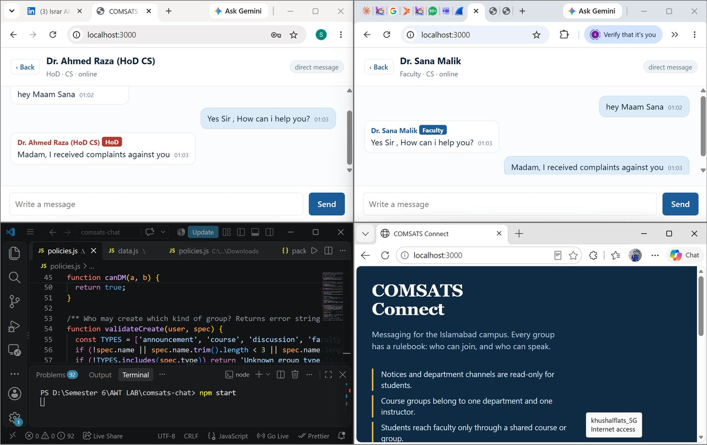
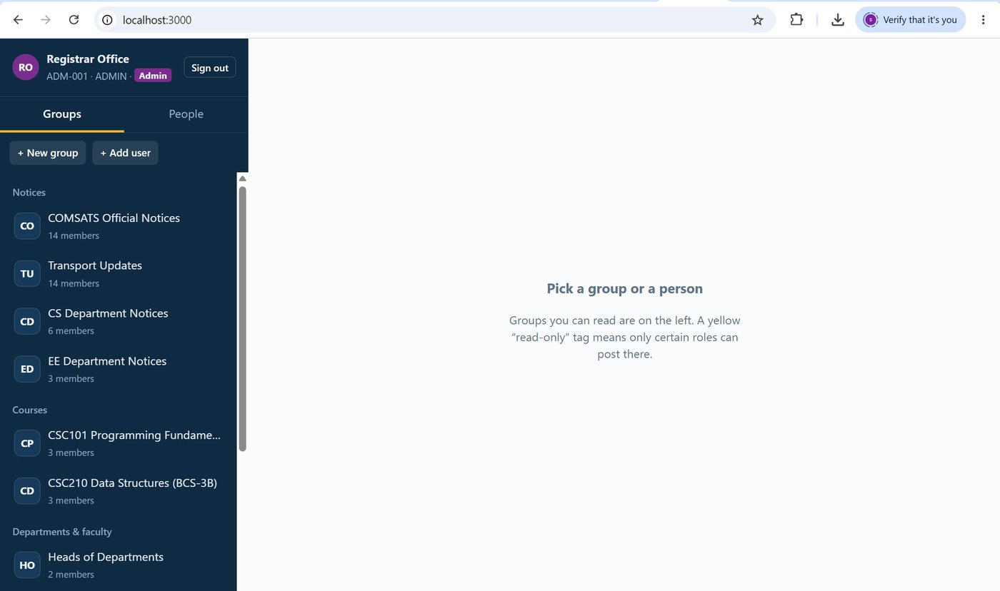
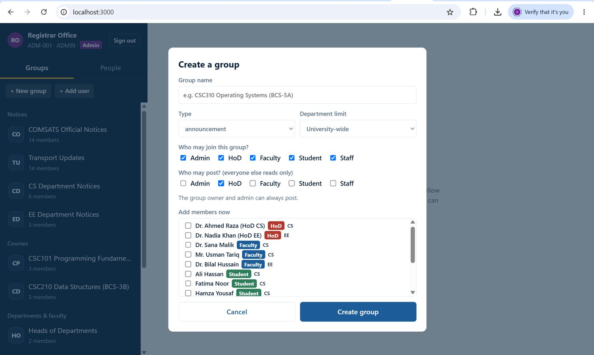
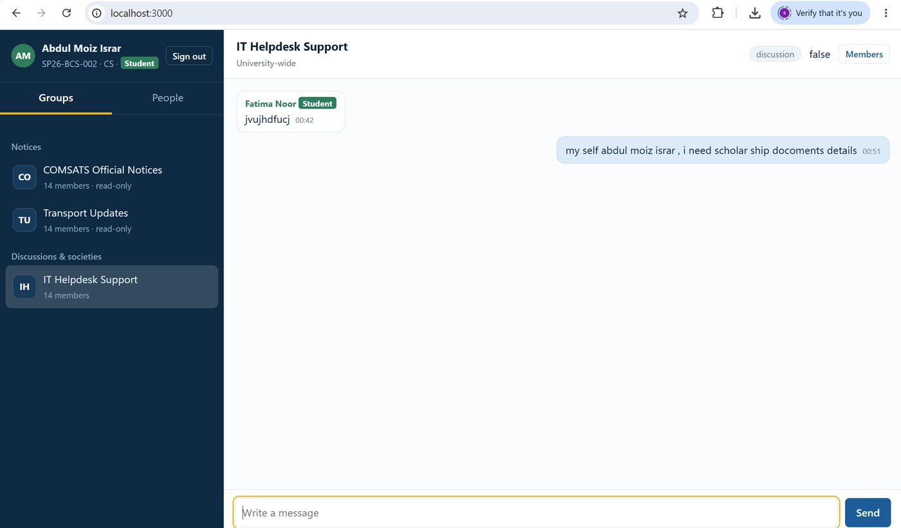
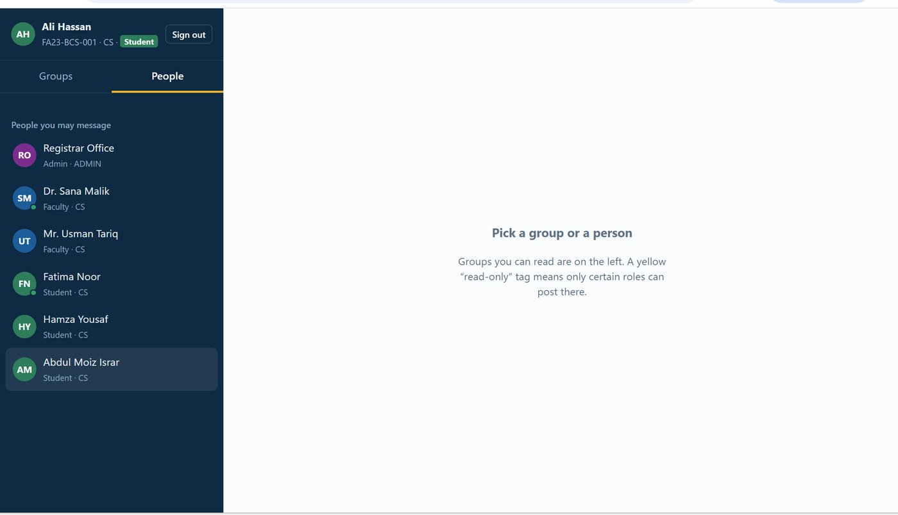
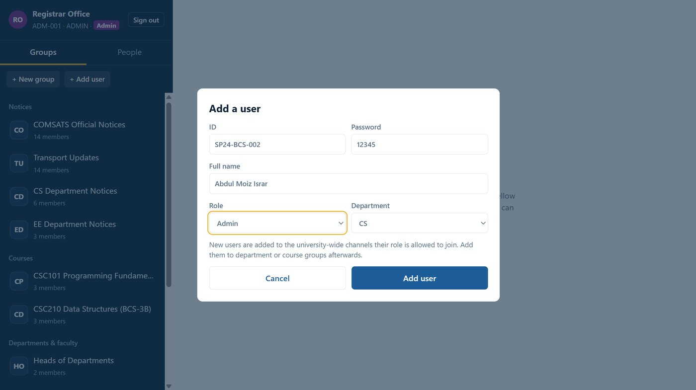
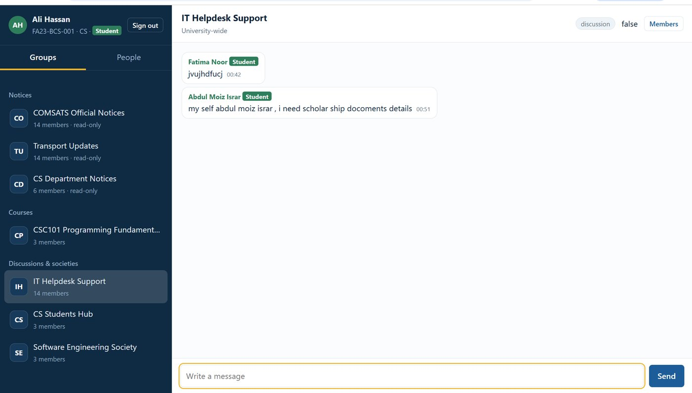

# COMSATS Connect

**A real-time, role-based campus messaging system built with Node.js and Socket.IO.**


Most chat apps are open rooms. A university is not. Official notices should be read-only for students, a course group belongs to one department and one instructor, and a first-year student should not be able to message every faculty member on campus.

COMSATS Connect models those rules. Every group has a **rulebook** (who can join, who can speak) and every direct message goes through a policy check. All rules are enforced **on the server**, so the browser can't bypass them.

> Unofficial student project. It is not affiliated with or endorsed by COMSATS University Islamabad. The name is used only because the scenarios are modelled on campus communication.



## Features

- **Real-time messaging** over Socket.IO: group chat, direct messages, online presence, typing indicator, unread counts.
- **Admin-managed users.** Only the admin office can add users (ID, name, role, department). Unknown IDs cannot sign in.
- **Group creation with limits by role.** Admin creates any group, HoD creates groups in their own department, faculty create course and discussion groups for their department. Students and staff cannot create groups.
- **Per-group boundaries.** Each group defines which roles may join, which roles may post, and an optional department limit.
- **Read-only announcement channels.** Students see notices but cannot post in them.
- **Moderation.** Group owner, HoD of the department, or admin can add, remove, mute members or delete a group.
- **Direct-message rules.** Student to student only inside the same department; student to faculty only through a shared course, society or discussion group.
- **Server-side enforcement** for every Socket.IO event, plus basic flood control and XSS-safe rendering (all user text is inserted as text, never as HTML).
- **Automated boundary tests** (20 checks) that run real Socket.IO clients against the server.

## Screenshots

| Admin dashboard | Create a group |
|---|---|
|  |  |

| Student sees read-only notices | Who a student may message |
|---|---|
|  |  |

| Add a user (admin only) | Real-time group chat |
|---|---|
|  |  |

## Roles and communication boundaries

| Role | Example | Can do |
|---|---|---|
| Admin | Registrar Office | Add users, create any group, post anywhere, message anyone |
| HoD | Head of CS / EE | Create groups in own department, manage members, post notices |
| Faculty | Course instructors | Create course and discussion groups in own department |
| Student | BCS / BEE / BSE | Read notices, post in groups where allowed, chat with classmates |
| Staff | Transport, IT Helpdesk | Broadcast updates, answer queries |

| Boundary | Rule |
|---|---|
| Join a group | Role must be in the group's `allowedRoles`; if the group has a department, the user must belong to it |
| Read a group | Members only (and admin) |
| Post in a group | Roles in `postRoles`, plus the group owner and admin. Muted members cannot post |
| Create groups | Admin: any. HoD: own department. Faculty: course or discussion in own department. Others: none |
| Manage a group | Admin, group owner, or HoD of the group's department |
| Add users | Admin only |
| Direct messages | Admin with everyone. Student to student: same department. Student to faculty/HoD/staff: only via a shared course, society or discussion group. Faculty, HoD and staff: freely |

Announcement and university-wide groups are deliberately **not** counted as a "shared group" for direct messages. Otherwise every student would share a group with every teacher and the rule would never block anything.

## Seed groups

| Group | Type | Who can join | Who can post |
|---|---|---|---|
| COMSATS Official Notices | announcement | All | Admin |
| Transport Updates | announcement | All | Admin, Staff |
| IT Helpdesk Support | discussion | All | All |
| Heads of Departments | faculty | HoD | HoD |
| CS Department Notices | announcement (CS) | HoD, Faculty, Student | HoD |
| CS Faculty Room | faculty (CS) | HoD, Faculty | HoD, Faculty |
| CS Students Hub | discussion (CS) | Student | Student |
| CSC101 Programming Fundamentals | course (CS) | Faculty, Student | Faculty, Student |
| CSC210 Data Structures | course (CS) | Faculty, Student | Faculty |
| EE Department Notices | announcement (EE) | HoD, Faculty, Student | HoD |
| Software Engineering Society | society | Student, Faculty | Student, Faculty |

The group owner and admin can always post.

## Getting started

Requirements: [Node.js](https://nodejs.org) 18 or newer.

```bash
git clone https://github.com/<your-username>/comsats-connect.git
cd comsats-connect
npm install
npm start
```

Open <http://localhost:3000>. To use another port: `PORT=3001 npm start` (macOS/Linux) or `set PORT=3001 && npm start` (Windows cmd).

Open two browsers (or a normal and a private window) and sign in as different users to watch the boundaries working.

### Demo accounts

Password for every demo account is `123`.

| ID | Role | Name |
|---|---|---|
| `ADM-001` | Admin | Registrar Office |
| `EMP-100` | HoD (CS) | Dr. Ahmed Raza |
| `EMP-110` | HoD (EE) | Dr. Nadia Khan |
| `EMP-201` / `EMP-202` | Faculty (CS) | Dr. Sana Malik / Mr. Usman Tariq |
| `EMP-301` | Faculty (EE) | Dr. Bilal Hussain |
| `FA23-BCS-001` / `002` / `003` | Student (CS) | Ali Hassan / Fatima Noor / Hamza Yousaf |
| `FA23-BEE-001` | Student (EE) | Zainab Iqbal |
| `SP24-BSE-001` | Student (SE) | Omar Farooq |
| `STF-01` / `STF-02` | Staff | Transport Office / IT Helpdesk |

To add your own user, sign in as `ADM-001` and click **+ Add user**, or add a line to the seed list in `data.js`.

## Tests

```bash
npm test
```

The test starts the server on port 3111, connects real Socket.IO clients (students, faculty, HoD, admin) and checks 20 rules: login, read-only channels, group visibility, role-restricted group creation, department limits, muting, and direct-message boundaries.

## Project structure

```
comsats-connect/
├── server.js            # Express + Socket.IO server, events, rooms, presence
├── policies.js          # Every communication boundary in one place
├── data.js              # In-memory users, groups, history + seed data
├── public/index.html    # Single-page client (no framework)
├── tests/boundary.test.js
└── docs/                # Screenshots and project report
```

## Socket.IO events

| Event | Direction | Purpose |
|---|---|---|
| `connection` (auth) | client to server | Login with ID and password in the handshake |
| `state` | server to client | Profile, visible groups, allowed contacts |
| `presence` | server to client | Who is online |
| `group:message`, `group:history` | client to server | Post / load group messages (members only) |
| `dm:message`, `dm:history` | client to server | Direct messages, checked by `canDM` |
| `message` | server to client | New message, sent only to the right room |
| `typing` | both | Typing indicator |
| `user:create` | client to server | Admin adds a user |
| `group:create`, `group:addMember`, `group:removeMember`, `group:toggleMute`, `group:delete` | client to server | Group management, each permission-checked |

## Known limitations

- **Data is in memory.** Users, groups and messages reset when the server restarts.
- **Passwords are plain text** in the seed data. This is fine for a demo and not for production.
- Login uses the Socket.IO handshake only (no sessions or tokens), and there is no TLS in this setup.

## Roadmap

- [ ] Persistent storage (MongoDB or PostgreSQL)
- [ ] Password hashing (bcrypt) and JWT / session auth
- [ ] File and image attachments
- [ ] Society presidents who can create and manage their own societies
- [ ] Message search, read receipts, push notifications
- [ ] Docker setup

## Contributing

Issues and pull requests are welcome. Please run `npm test` before opening a PR, and keep new permission rules inside `policies.js` so they stay in one place.

## License

[MIT](LICENSE) © 2026 Abdul Moiz Israr
